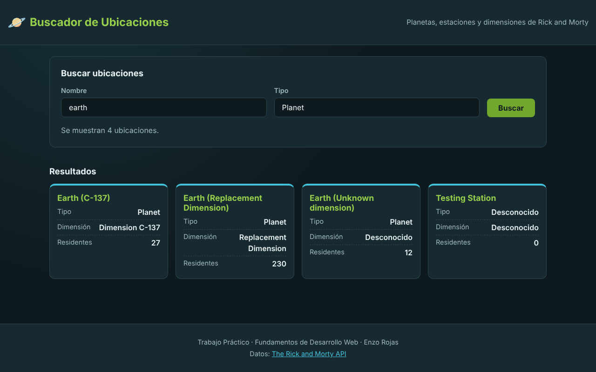

# Buscador de Ubicaciones · Rick and Morty

**Autor:** Enzo Rojas
**Materia:** Fundamentos de Desarrollo Web — Trabajo Práctico
**Variante:** B · Ubicaciones (endpoint `https://rickandmortyapi.com/api/location`)

🔗 **Página publicada:** https://TU-USUARIO.github.io/tp-rojas-enzo/

## Descripción

Página web de una sola pantalla que busca ubicaciones de la serie Rick and Morty usando la [Rick and Morty API](https://rickandmortyapi.com/documentation). Se puede buscar por **nombre** y filtrar por **tipo** (por ejemplo, `Planet`), y ambos criterios se envían juntos en la misma petición (`?name=...&type=...`).

Cada resultado se muestra en una tarjeta con el **nombre**, el **tipo**, la **dimensión** y la **cantidad de residentes**. Los datos vacíos o `unknown` se muestran como «Desconocido».

## Funcionalidades

- Formulario semántico con `<label>` en cada campo y aviso si se busca sin ningún criterio.
- Petición con `fetch` y `async/await`; la URL se arma con `new URL()` y `searchParams`.
- Tarjetas creadas con `createElement` y `textContent`, ubicadas con CSS Grid (`repeat(auto-fill, minmax(...))`).
- Estados: «Buscando…» con el botón desactivado, «sin resultados» (404) y mensaje de error (`try/catch`); el botón se vuelve a habilitar en `finally`.
- La última búsqueda se guarda en `localStorage` y se repite sola al recargar la página.
- Diseño responsive con variables CSS; se ve bien a 375 px sin desplazamiento horizontal.

## Estructura

```
tp-rojas-enzo/
├── index.html
├── README.md
├── css/
│   └── estilos.css
├── js/
│   └── app.js
└── img/
    └── captura.png
```

## Captura de pantalla


